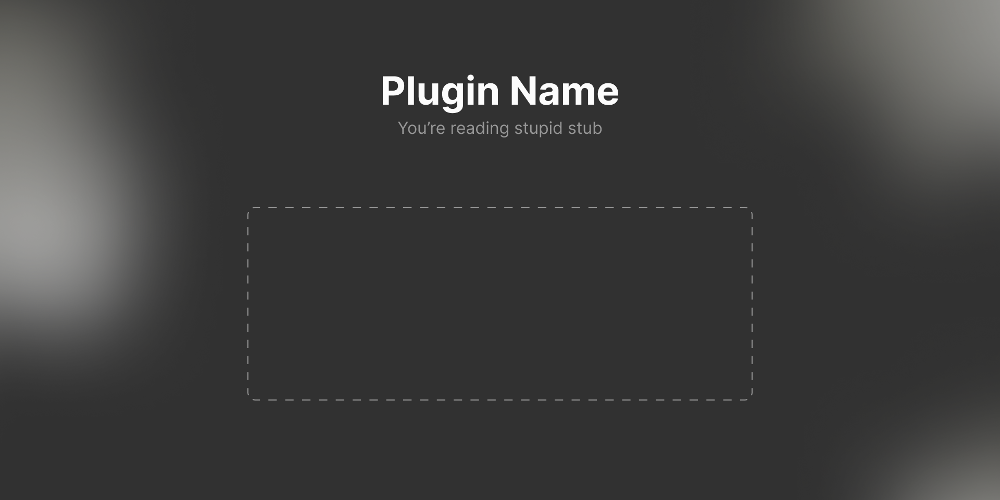

# Difference for Figma

Pixel comparison of two frames, instantly. No UI.

### How to use

Select **exactly two frames** and run the plugin from Quick Actions or the Plugins menu.

A new `Comparison` frame appears 32px below the lowest of the two frames, selected and zoomed into view.

### How it works

Both frames are exported as 2x PNG snapshots, compared pixel by pixel, and the result is placed in one frame with three fills (top to bottom):

| Fill | Opacity | Blend |
| --- | --- | --- |
| Overlay — changed pixels in red, unchanged ones transparent. Stronger changes are more opaque | 100% | Normal |
| Second frame snapshot | 50% | Normal |
| First frame snapshot | 100% | Normal |

- **First / second** — the left frame is first (the top one if both share the same X).
- **Different sizes** — snapshots are aligned to the top left corner. The comparison takes the larger width and height, and the empty area counts as changed.
- **Even mix** — the first snapshot is at 100% and the second at 50% on top, which shows each at exactly half strength at full brightness. Two 50% fills would only reach 75% opacity, and the first would count for half as much as the second.
- **Position** — the comparison is horizontally centered on the average of both frames' centers, with its top 32px below the bottom of the lower frame.
- **Large frames** — Figma limits images to 4096px, so a frame over 2048px on either side is snapshotted at a lower scale. The notification tells you when that happens.
- The notification shows how many pixels differ.

Frames, components, component sets and instances can be compared.

Settings (scale, overlay blend mode, snapshot opacities, gap) live in [src/config.ts](src/config.ts); the overlay color and alpha range are at the top of [src/pages/index.astro](src/pages/index.astro).

### Development

1. Run `npm i`
2. Run `npm run dev` to rebuild `dist/` on every change, or `npm run build` once
3. In the Figma desktop app: Actions `⌘K` › Plugins & Widgets › Import from manifest › pick `manifest.json`

The plugin sandbox has no canvas, so PNG decoding, diffing and encoding run in a hidden UI iframe ([src/pages/index.astro](src/pages/index.astro)). [src/code.ts](src/code.ts) handles selection, export and the comparison frame.

### Feedback

I accept feature suggestions and ideas to improve the plugin. If you have any ideas or issues, let me know in the comments.

Or contact me via e-mail at [nick@qurle.net](mailto:nick@qurle.net?subject=Difference%20for%20Figma) or [Telegram](http://t.me/qurle).

# <3
